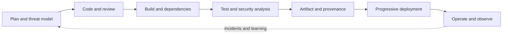

# Delivery and Security

Secure delivery is a system of feedback loops rather than a sequence of scanners. A change moves from intent to source, build, test, artifact, deployment, and operation. Each stage should produce evidence, reduce a known risk, and preserve enough context to diagnose failure.

## Follow the lifecycle

1. **[Plan](/docs/DevSecOps/process/0.plan):** establish requirements, risk, data use, ownership, and acceptance criteria.
2. **[Code](/docs/DevSecOps/process/1.code):** review changes, detect exposed secrets, and apply language-aware analysis.
3. **[Build](/docs/DevSecOps/process/2.build):** produce reproducible artifacts and account for dependencies and provenance.
4. **[Test](/docs/DevSecOps/process/3.test):** build confidence at the cheapest effective layer and test security properties.
5. **[Release](/docs/DevSecOps/process/4.release):** promote an immutable, identifiable artifact with its evidence.
6. **[Deploy](/docs/DevSecOps/process/5.deploy):** control exposure, verify outcomes, and retain a recovery path.
7. **[Operate](/docs/DevSecOps/process/6.operate):** own service health, change, access, capacity, and recovery.
8. **[Monitor](/docs/DevSecOps/process/7.monitor):** turn telemetry into user-impact and risk decisions.

## Design controls around risk

Avoid adding a tool without naming the failure it detects, its expected signal quality, and the action attached to a result. Fast checks belong close to the developer. Expensive integration or dynamic checks can run later, provided they do not become an unbounded release queue.

The [DevOps path](/docs/devops) covers delivery flow and software-supply-chain architecture. [Security and Compliance in Infrastructure](/docs/infrastructure/security-and-compliance) develops control ownership and evidence in more depth.
