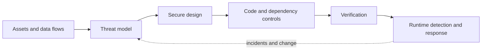

# Security Engineering

Security engineering protects valuable user and business outcomes against misuse, compromise, and failure. Start with assets, actors, data flows, trust boundaries, and credible threats; then choose controls and evidence proportionate to risk.

## Security lifecycle

## Curated notes

- **[Threat Modeling](/docs/Security/threat_model):** identify threats, mitigations, assumptions, and residual risk.
- **[OAuth 2.0](/docs/Security/OAuth):** reason about delegated authorization, tokens, clients, and redirect boundaries.
- **[Automated Code Review](/docs/Security/automated_code_review):** combine deterministic checks with human review.
- **[Dynamic Security Testing](/docs/Security/dynamic_application_security_testing):** test a running system without confusing scanner output for complete assurance.

Security controls should be owned, observable, and connected to a response. The [infrastructure security and compliance note](/docs/infrastructure/security-and-compliance) covers control evidence, exceptions, and continuous assurance.
