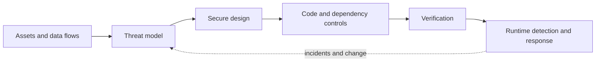
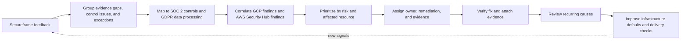

# Security Engineering

Security engineering protects valuable user and business outcomes against misuse, compromise, and failure. Start with assets, actors, data flows, trust boundaries, and credible threats; then choose controls and evidence proportionate to risk.

## Security lifecycle

## Compliance experience: SOC 2 and GDPR

Support SOC 2 and GDPR readiness by turning audit findings and platform security signals into owned engineering work. Use Secureframe feedback to identify evidence gaps, unclear control ownership, and recurring exceptions; group related findings into remediation themes instead of treating each request as a one-off task.

Correlate those themes with cloud posture and detection feedback from Google Cloud Platform and AWS Security Hub. For each finding, capture the affected resource, risk, control or requirement, owner, remediation, and evidence needed to verify closure. Prioritize exposed or high-impact issues first, automate repeatable checks where practical, and route exceptions through a documented risk owner and expiry.

For SOC 2, keep evidence tied to the control and the period in scope, and make operational ownership clear. For GDPR, connect findings to the data and processing activity involved, access boundaries, retention, and the response path. Treat Secureframe and cloud tools as sources of signals and evidence; confirm applicability and closure with the control owner rather than treating a dashboard status as proof by itself.

Review remediation feedback with engineering and compliance stakeholders, look for repeated causes, and feed those patterns into infrastructure defaults and delivery checks. This helps reduce recurring audit work while improving the underlying security posture.

## Curated notes

- **[Threat Modeling](/docs/Security/threat_model):** identify threats, mitigations, assumptions, and residual risk.
- **[OAuth 2.0](/docs/Security/OAuth):** reason about delegated authorization, tokens, clients, and redirect boundaries.
- **[Automated Code Review](/docs/Security/automated_code_review):** combine deterministic checks with human review.
- **[Dynamic Security Testing](/docs/Security/dynamic_application_security_testing):** test a running system without confusing scanner output for complete assurance.

Security controls should be owned, observable, and connected to a response. The [infrastructure security and compliance note](/docs/infrastructure/security-and-compliance) covers control evidence, exceptions, and continuous assurance.
