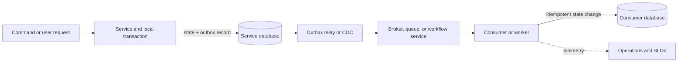

# Event-Driven Architecture

Event-driven architecture (EDA) models a system as producers that emit facts or requests and consumers that react asynchronously. It reduces temporal coupling: a producer need not wait for every downstream action to finish. That can improve isolation and allow independent scaling, but it moves complexity into contracts, delivery, recovery, and operations.

EDA is an interaction style, not a product category. Kafka, BullMQ, and Temporal all use events internally, but they solve different coordination problems:

| System | Primary abstraction | Best fit | Durable state it owns |
| --- | --- | --- | --- |
| Kafka | Partitioned, retained event log | Fan-out, replay, integration, and stream processing | Ordered records and consumer offsets, within configured retention |
| BullMQ | Redis-backed job queue | Background work with bounded execution, delay, priority, and retries | Job lifecycle and queue state |
| Temporal | Durable workflow execution | Multi-step business processes with timers, retries, external input, and compensation | Workflow history and progress |

Treat these as complementary tools. A system can use Kafka to distribute domain facts, BullMQ to perform disposable background work, and Temporal to coordinate a long-running business process. Add each only when its specific guarantee is needed.

## Start with the event contract

An **event** states that something already happened: `OrderPlaced`, `PaymentCaptured`, or `InventoryReserved`. A **command** asks a specific owner to do something: `CapturePayment` or `ReserveInventory`. Events are facts that may have many interested consumers; commands have an intended handler and can be rejected.

Name events in the past tense and define a stable envelope. A useful contract includes:

- event type and schema version;
- globally unique event ID and aggregate/entity ID;
- occurrence time and, when distinct, publication time;
- producer or source and correlation/causation IDs;
- payload with only the facts consumers need.

The event owner controls meaning and compatibility. Prefer additive schema evolution, define how consumers handle unknown fields and versions, and avoid treating an internal database row shape as a public event contract. Events should represent business facts, not merely mirror table writes.

## Design the flow and failure boundaries

The database write and message publication form a classic dual-write hazard: one can succeed while the other fails. Use a transactional outbox with a relay or change-data-capture mechanism so the business change and publication intent commit together. Consumers still need idempotency: a broker can redeliver after a consumer commits its work but before it acknowledges progress. Store a processed event ID, use a natural idempotency key, or make the state transition itself safely repeatable.

Do not promise end-to-end exactly-once side effects across independent databases and services. State the actual guarantee at each boundary, then make retries safe. For external effects such as charging a card or sending a notification, pass a stable idempotency key to the provider where possible and reconcile uncertain outcomes.

Ordering is also scoped. Decide which entity needs order, use that entity as the partition or routing key, and ensure the consumer does not parallelize those records in a way that violates it. Global order usually limits concurrency and is rarely a genuine business requirement.

## Kafka: retain and distribute streams

Kafka is an event-streaming platform. Producers append records to topic partitions. Records with the same key are routed to the same partition, which provides order within that partition. Consumer groups divide partition ownership among group members; separate groups can independently read the same retained stream.
A consumer's offset records its position and allows it to resume or replay, subject to retention and compaction policy. See the [Apache Kafka introduction](https://kafka.apache.org/documentation/) and [design documentation](https://kafka.apache.org/design/).

Use Kafka when multiple independent consumers need the same facts, when replay or rebuilding derived views matters, or when a high-volume stream feeds analytics and processing systems. It is a poor fit for tiny one-off background tasks whose main needs are delay and simple retry, or as a workflow engine for a business process that waits days for a human decision.

Principal-level design questions include:

- **Partitioning:** What key preserves required ordering, and how many partitions are needed for target throughput and consumer parallelism?
- **Retention:** How long must replay be possible? Which data is compacted, expired, or subject to deletion requirements?
- **Progress:** When is an offset committed relative to durable side effects? What happens when the process fails between the effect and commit?
- **Evolution:** Who owns schemas, compatibility policy, and migration of old events and consumers?
- **Operations:** How are consumer lag, partition skew, under-replicated partitions, and replay load controlled?

Kafka's log is not a substitute for a domain database or an audit policy. Retention, compaction, replication, access control, and recovery objectives must match the product's actual obligations.

## BullMQ: dispatch background jobs

BullMQ is a Node.js job queue built on Redis. A producer adds a job; workers claim and process it. Job state supports work such as waiting, active, delayed, completed, or failed, with concurrency, priorities, rate limits, and configurable retry/backoff behavior.
It is suited to bounded units of asynchronous work: resize an image, send a receipt, or generate a report. See BullMQ's [architecture](https://docs.bullmq.io/guide/architecture), [workers](https://docs.bullmq.io/guide/workers), and [retry guidance](https://docs.bullmq.io/guide/retrying-failing-jobs).

BullMQ's job queue is not a retained, multi-consumer event history. A job is work to perform, not necessarily a domain fact that every downstream system should independently replay. Its operational durability depends on Redis persistence, replication, recovery, and retention configuration; design those as part of the service's reliability model.

Assume jobs can run more than once. Make processors idempotent, set explicit attempt and backoff limits, classify permanent versus transient failures, and define what operators do with exhausted jobs. Monitor oldest job age, throughput, active workers, stalled jobs, retry rate, and failed-job growth. Scale workers only while downstream dependencies have capacity; otherwise extra concurrency converts queue delay into dependency overload.

## Temporal: coordinate durable workflows

Temporal is a durable execution platform for workflows: code that coordinates a process across activities, retries, timers, and external input. A workflow's event history lets Temporal replay its deterministic workflow code and restore progress after worker or infrastructure failures.
Signals and updates can change a running workflow; activities perform side effects. See [What is Temporal?](https://docs.temporal.io/temporal), [workflow execution](https://docs.temporal.io/workflow-execution), and [event history](https://docs.temporal.io/encyclopedia/event-history).

Is Temporal event-driven? **In a broad sense, yes:** workflow tasks are scheduled in response to events such as a workflow start, a signal, an activity result, or a timer firing. More precisely, Temporal is a **durable workflow orchestration system**, not a general-purpose event broker. It reacts to events to advance a specific process instance; Kafka distributes retained streams to independent consumers, while BullMQ dispatches jobs to workers.

Use Temporal when the process itself has durable state and lifecycle: a saga across services, an approval that may wait days, an order with deadlines and compensation, or an operation that must resume after failures. It can replace hand-built state machines, retry loops, and timer tables.
It does not remove the need to design idempotent activities, workflow versioning, payload limits, external system consistency, and worker operations. Workflow code must remain deterministic during replay; side effects belong in activities or supported workflow APIs.

## Choose by the coordination problem

| Requirement | Prefer | Reason |
| --- | --- | --- |
| Several consumers need independent copies of facts, with replay | Kafka | Retained partitions and per-consumer-group offsets |
| Execute bounded background jobs with delays and retries | BullMQ | Job lifecycle, worker concurrency, and queue controls |
| Persist progress across a multi-step process with timers and external decisions | Temporal | Durable workflow state, history, and replay |
| Persist one event for downstream publication after a database transaction | Transactional outbox, often with Kafka or another broker | Resolves the database/broker dual-write gap |
| Deliver a small internal task with minimal infrastructure | Existing database-backed queue or platform task service | Avoid operating a distributed system before its guarantees are needed |

Do not select by throughput headline alone. Compare the required ordering scope, replay horizon, retry semantics, latency, failure isolation, operational ownership, security, data retention, and cost at expected load. A broker can buffer work; it cannot make an overloaded dependency healthy. A workflow engine can persist orchestration state; it cannot make external side effects transactional.

## Operate the architecture as a product

Instrument the whole path with event ID, aggregate ID, trace context, and correlation ID. Measure publish failures, oldest unprocessed age, consumer lag, processing duration, retry and duplicate rates, dead-letter or failed-job growth, and end-to-end business latency. Define SLOs on outcomes such as “95% of accepted orders reach a decision within two minutes,” not merely broker availability.

Every asynchronous boundary needs an owner, schema policy, replay procedure, redrive policy, retention decision, and incident runbook. Test recovery by killing consumers between side effect and acknowledgement, replaying an event version, exhausting retries, and simulating downstream saturation. The architecture is complete when teams can explain what happened, safely resume work, and know who owns the remaining failure.

For delivery semantics and backlog operations, continue with [Messaging and Queues](/docs/System-Design/Basics/message_broker).
