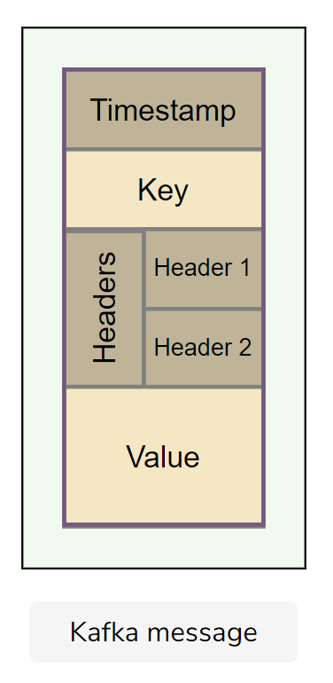
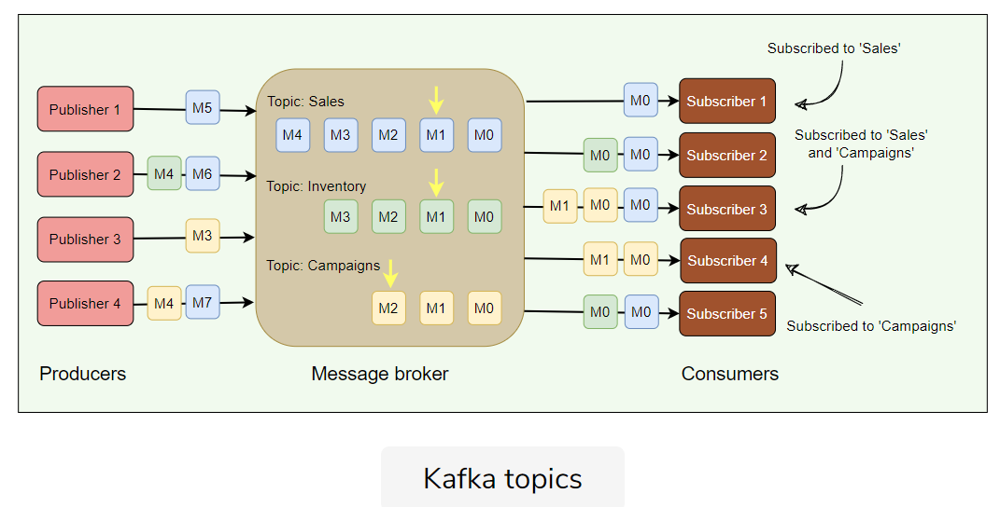
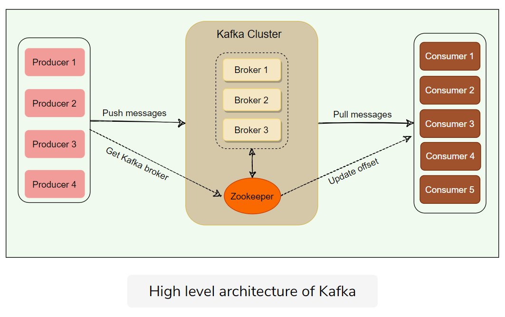

# Kafka

> **Archive note:** This study note is retained for historical reference and is not part of the curated Learn path.

## High-level Architecture

### Common termns

**Brokers**: they receive data from producers, reliably store them and provide them into consumers.

**Records**: A message or an event stored in Kafka.

### Topics

Topics are message categories. Each message should have a topic. Consumer can subscribe to the topics.

### Producers

Publish records to Kafka

### Consumers

Subscriber of kafka topics.

### High Level Architecture

