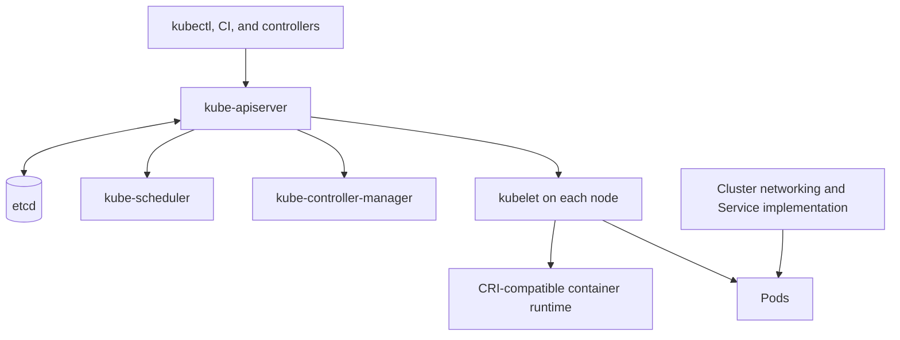

# Kubernetes Concepts

Kubernetes is a control system for declaring and reconciling workload state. Its value comes from a consistent API and controller model; its cost is an additional distributed control plane, policy surface, upgrade lifecycle, and operational dependency.

## Architecture

The API server authenticates and authorizes requests and persists desired state in etcd. Controllers watch objects and reconcile current state toward the specification. The scheduler assigns unscheduled Pods to nodes. A kubelet ensures assigned Pods and containers run through a Container Runtime Interface (CRI)-compatible runtime such as containerd or CRI-O.

Docker can still build Open Container Initiative images, but Kubernetes removed its built-in `dockershim` integration in version 1.24. Docker-built images remain portable to compatible runtimes after they are pushed to a registry.

## Workload APIs

- **Pod:** smallest schedulable unit; one or more containers sharing network and selected storage.
- **Deployment:** manages stateless replicas and rolling updates through ReplicaSets.
- **StatefulSet:** provides stable identity and ordered lifecycle; it does not make an application stateful or replicated by itself.
- **DaemonSet:** runs a Pod on selected nodes, often for infrastructure agents.
- **Job and CronJob:** represent finite and scheduled work.
- **Service:** stable virtual access to a selected set of endpoints.
- **Ingress or Gateway API:** configures supported north–south routing implementations.

Requests influence scheduling and capacity; limits constrain runtime consumption. Readiness controls whether an endpoint receives traffic. Liveness restarts a stuck process and can amplify an outage when it tests a failing dependency. Startup probes protect slow initialization.

## Configuration, identity, and state

ConfigMaps hold non-secret configuration. Secrets are API objects with access-control and encryption considerations; base64 is encoding, not encryption. Use workload identity where available and restrict service-account tokens and RBAC permissions.

PersistentVolumeClaims request storage through a StorageClass and CSI driver. Define backup, restore, topology, and application-consistency requirements outside the claim itself.

Namespaces organize and delegate resources but are not automatically a strong tenant-security boundary. Combine RBAC, network policy, admission controls, quotas, node isolation, and runtime hardening according to risk.

Continue with [Kubernetes Operations](/docs/Tools/k8s/k8s_operations) and the [service lab](/labs/build-and-operate-a-service).
