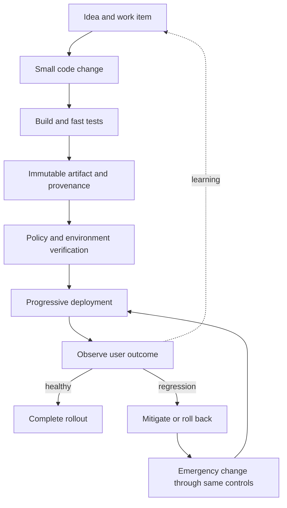

# DevOps

DevOps is a socio-technical operating model for moving changes from an idea to a dependable production outcome. At staff level, the work is to improve the whole value stream across team boundaries: shorten feedback, reduce batch size, make the safe path easy, and design recovery as carefully as delivery.

## Model the two delivery paths

The normal path delivers value. The recovery path restores service when a change fails. Both need short lead time; a fast feature pipeline with a slow emergency path is not high-performing delivery.

## Find the constraint before buying tools

Map one real change from commitment to verified production. Record elapsed time, active work time, queue time, handoffs, rework, and approval delay. The largest queue or repeated rework loop is usually a better improvement target than replacing the CI product.

The current DORA model groups delivery outcomes into:

- **Throughput:** change lead time, deployment frequency, and failed-deployment recovery time.
- **Instability:** change fail rate and deployment rework rate.

Measure these per service and over time. Organization-wide averages hide constrained teams and different risk profiles. Pair delivery measures with user outcomes, reliability, security, and team health so local optimization does not move cost elsewhere.

## Design the delivery architecture

A mature path has explicit contracts between stages:

1. **Source:** Protected mainline, small changes, peer review proportional to risk, and traceability to intent.
2. **Build:** Hermetic enough to reproduce, pinned dependencies, fast deterministic checks, and isolated untrusted code.
3. **Artifact:** Build once, promote the same immutable artifact, record provenance, generate an SBOM, and sign where the threat model requires it.
4. **Configuration:** Keep environment configuration versioned, validate schemas, and separate secrets from ordinary values.
5. **Release:** Decouple deployment from exposure with feature flags when useful. Use canaries, blue/green rollout, or staged cohorts according to risk.
6. **Verification:** Test the user journey, compare leading indicators, and automate rollback only when the signal is trustworthy.
7. **Audit:** Preserve who approved what, which artifact ran, which policy evaluated it, and what happened afterward.

Every manual gate should state the risk it controls. If automation can supply the same evidence with better consistency, automate it. If judgment is still required, put the decision near the evidence and measure its queue time.

## Make changes safe by design

High deployment frequency is an outcome of small, reversible, observable changes—not a target to force in isolation.

- Keep database changes backward compatible across mixed application versions; expand, migrate, verify, then contract.
- Separate rollout from release so exposure can stop without rebuilding.
- Use bounded canaries with predefined success and abort criteria.
- Test rollback and roll-forward paths, including stateful changes.
- Run emergency changes through the same version control, artifact, and audit path with an accelerated risk policy.
- Prefer short-lived credentials and workload identity over long-lived CI secrets.

## Treat the software supply chain as production

The delivery system can modify every workload, so its trust boundary deserves the same rigor as the runtime platform. Limit who can change workflows, isolate runners, pin third-party actions, protect signing keys, and prevent a pull request from acquiring deployment credentials before trusted review.

Separate control-plane compromise from application defects in the threat model. A passing test suite does not establish that the builder, dependency, artifact registry, or deployment identity is trustworthy.

## Change the operating model

Tools cannot repair ownership gaps. Product teams should own software through production, supported by enabling teams and shared platforms. Operations, security, and compliance expertise should shape the paved path and remain available for high-risk decisions.

Staff-level interventions often include:

| Symptom | Likely system cause | Intervention |
| --- | --- | --- |
| Long lead time, little active work | Queues and cross-team handoffs | Move capability into the team or expose it as self-service |
| Fast pipeline, frequent incidents | Weak tests, large batches, poor rollout signals | Reduce batch size; improve verification and progressive delivery |
| Many bespoke pipelines | Missing product ownership for shared delivery | Publish versioned templates with support and migration policy |
| Approval backlog | Controls detached from evidence | Automate evidence and use risk-based approval |
| Emergency fixes bypass CI | Recovery path is too slow | Make the normal path fast enough for emergencies |
| Metrics improve, teams burn out | Targets are being gamed or work is unsustainable | Revisit incentives and add team-health constraints |

## Govern shared delivery capabilities

Standardize interfaces and evidence rather than forcing every repository into identical internals. Define supported pipeline contracts, artifact metadata, deployment events, policy results, and observability hooks. Version shared workflows, publish breaking-change policy, test migrations, and provide an escape path with recorded ownership.

Use platform adoption as a signal, not a mandate. Teams avoiding the shared path may expose missing capabilities, poor usability, or a workload that genuinely needs a different risk model.

## Review delivery like a staff engineer

Extend the [service lab](/labs/build-and-operate-a-service) into a delivery design:

1. Draw its normal and recovery value streams, including every wait and handoff.
2. Define the artifact, provenance, promotion, configuration, and deployment contracts.
3. Choose a progressive rollout strategy and measurable abort conditions.
4. Explain how a schema change remains compatible during rollback.
5. Threat-model the CI identity, runner, dependencies, registry, and production deployer.
6. Choose one constraint, propose an intervention, and state the leading and outcome metrics.

## Evidence of principal-level depth

A credible demonstration includes a value-stream map with measured queues, a reusable delivery contract, a supply-chain threat model, a progressive-delivery design, an emergency-change path, and a before/after analysis using delivery, reliability, and team-health outcomes.

Continue with [Docker](/docs/Tools/docker), [GitHub Actions](/docs/Tools/CICD/github-actions), the [build](/docs/DevSecOps/process/2.build), [test](/docs/DevSecOps/process/3.test), and [deployment](/docs/DevSecOps/process/5.deploy) stages. DORA's [delivery performance guide](https://dora.dev/guides/dora-metrics/) and [value-stream guidance](https://dora.dev/guides/value-stream-management/) provide a research-backed measurement model.
