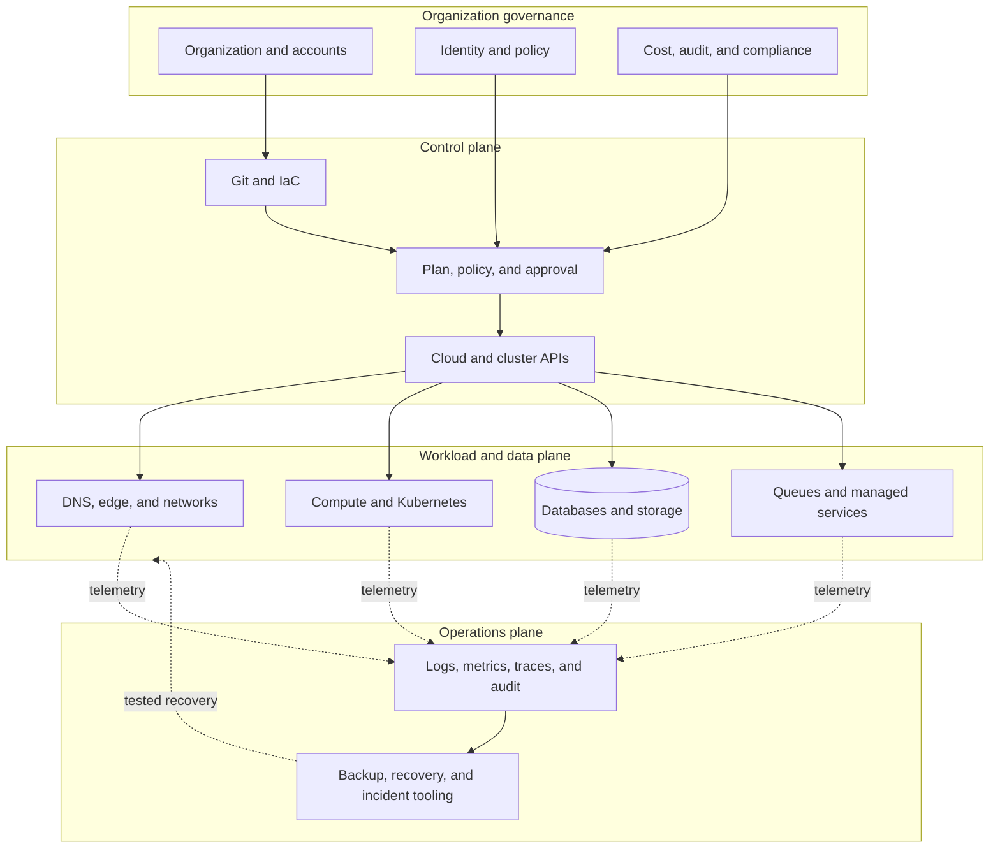

# Infrastructure Engineering

Infrastructure engineering creates the shared technical foundation on which products run. At staff and principal scope, the work is to define stable interfaces across cloud accounts, identity, networking, compute, data, and operations while managing failure blast radius, security exposure, cost, and organizational autonomy.

## Think in planes and layers

Separate the **control plane**, which changes the system, from the **data plane**, which serves traffic. A control-plane outage should not immediately stop healthy workloads, and a compromised workload should not gain authority to change the foundation.

## Define the foundation contract

A cloud foundation or landing zone normally establishes:

- organization, account, subscription, project, folder, and billing boundaries;
- workforce and workload identity, federation, privileged access, and break-glass procedures;
- IP address management, DNS, ingress, egress, private connectivity, and network inspection;
- baseline audit logs, telemetry export, encryption, key ownership, and retention;
- approved regions, service policies, tagging, budgets, and resource ownership;
- reusable IaC modules and the workflow that plans, approves, applies, and recovers them.

The foundation should expose versioned contracts. Application teams need to know what the platform guarantees, what they own, and how breaking changes are introduced.

## Choose boundaries deliberately

Isolation is a design variable. Accounts, clusters, virtual networks, namespaces, cells, and regions each contain some failures while adding operational cost.

| Boundary | Useful for | Principal-level concern |
| --- | --- | --- |
| Account or project | Billing, policy, IAM, hard quotas | Fleet-wide policy and cross-account access |
| Network | Reachability and traffic inspection | Address exhaustion, transitive routing, shared egress |
| Cluster | Runtime and control-plane isolation | Upgrade fleet, noisy neighbors, shared operators |
| Namespace or tenant | Delegation within a cluster | Weak isolation assumptions and quota fairness |
| Cell | Limiting customer and deployment blast radius | Placement, routing, capacity, data ownership |
| Region | Disaster and latency boundaries | Data consistency, failover confidence, duplicated cost |

Avoid a single global foundation that turns every change into an organization-wide event. Also avoid fragmentation so deep that security fixes, upgrades, and cost controls cannot be applied consistently. The useful point depends on risk, scale, and team capability.

## Engineer the network and identity paths

Start with flows, not products. Document who initiates each connection, which identity is presented, how policy is evaluated, where encryption terminates, and which logs prove the decision.

Prefer explicit ingress and egress, private service connectivity where it reduces exposure, workload identity instead of distributed static credentials, and default-deny policies with observable exceptions. Plan DNS, certificate lifecycle, IP ranges, NAT capacity, and failure behavior early; they become expensive to change after many teams depend on them.

## Select compute and data from requirements

Choose managed services, virtual machines, containers, Kubernetes, serverless, or edge runtimes by workload needs: isolation, latency, portability, scaling shape, operational ownership, and recovery objectives. Kubernetes is valuable when its scheduling and extensibility solve real multi-workload problems; it also creates an API, upgrade, policy, and operational surface that somebody must own.

For data, state the consistency, durability, residency, retention, throughput, recovery-point objective (RPO), and recovery-time objective (RTO) before selecting technology. Replication is not backup. A backup is only credible after restoration has been exercised into a usable environment and the recovered application has been verified.

## Operate infrastructure as a product

Infrastructure needs lifecycle ownership:

1. **Provision:** Versioned modules, policy checks, quotas, ownership metadata, and cost estimates.
2. **Change:** Small plans, clear blast radius, compatibility, maintenance strategy, and rollback or roll-forward.
3. **Observe:** Control-plane health, saturation, quota pressure, audit activity, and tenant-facing service levels.
4. **Recover:** Tested restore, regional failover, break-glass access, and control-plane bootstrap.
5. **Upgrade:** Supported versions, dependency sequencing, fleet rollout, and deprecation windows.
6. **Retire:** Data disposition, access removal, dependency confirmation, and cost verification.

The [Infrastructure as Code](/docs/infrastructure/infrastructure-as-code) note develops the change-control model. [Security and Compliance](/docs/infrastructure/security-and-compliance) connects controls to evidence and continuous assurance.

## Balance reliability, security, and cost

Staff-level infrastructure decisions make tradeoffs visible instead of optimizing one dimension silently.

| Proposal | Reliability question | Security question | Cost question |
| --- | --- | --- | --- |
| Multi-region service | Has failover been tested under real dependencies? | How are keys, identities, and data residency handled? | Is active capacity justified by the recovery objective? |
| Shared cluster | What is the noisy-neighbor and upgrade blast radius? | Is tenant isolation strong enough for the data? | Does utilization offset operational complexity? |
| Managed database | What failure and maintenance behavior is promised? | Who controls encryption, access, and audit logs? | How do storage, I/O, replicas, and egress scale? |
| Central egress | What happens when inspection is saturated or unavailable? | Which flows are enforced and evidenced? | What are appliance, NAT, and cross-zone charges? |

Use unit economics—cost per request, tenant, build minute, or stored object—alongside total spend. Allocation tags and ownership metadata help teams act; opaque chargeback reports rarely change architecture.

## Govern without becoming a ticket queue

Encode stable, high-confidence rules in organization policy and reusable modules. Keep contextual decisions in architecture review with recorded rationale. Provide paved paths for common workloads and a time-bounded exception process for legitimate edge cases.

Every standard needs an owner, scope, enforcement point, migration path, and retirement condition. A policy with no remediation path creates hidden workarounds; a module with no compatibility promise becomes a shared liability.

## Review infrastructure like a principal engineer

Extend the [service lab](/labs/build-and-operate-a-service) into a production foundation design:

1. Draw the request, identity, control, telemetry, and recovery paths.
2. Mark every account, network, cluster, region, and data failure boundary.
3. Define RPO, RTO, capacity headroom, overload behavior, and a tested recovery exercise.
4. Propose the IaC stack boundaries, state ownership, promotion workflow, and policy checks.
5. Threat-model control-plane credentials and show the audit evidence for a production change.
6. Estimate the largest cost drivers and choose unit metrics that expose inefficient growth.
7. Write one architecture decision record with alternatives, consequences, and a revisit trigger.

## Evidence of principal-level depth

A strong demonstration includes a landing-zone model, network and identity flows, failure-domain analysis, reusable IaC contracts, disaster-recovery evidence, a policy exception design, and a cost model tied to workload demand.

Continue with [Docker](/docs/Tools/docker), [Kubernetes concepts](/docs/Tools/k8s/k8s_concepts), [Kubernetes operations](/docs/Tools/k8s/k8s_operations), and the cloud notes for [AWS](/docs/DevSecOps/Cloud/AWS), [Azure](/docs/DevSecOps/Cloud/Azure), and [GCP](/docs/DevSecOps/Cloud/GCP).
