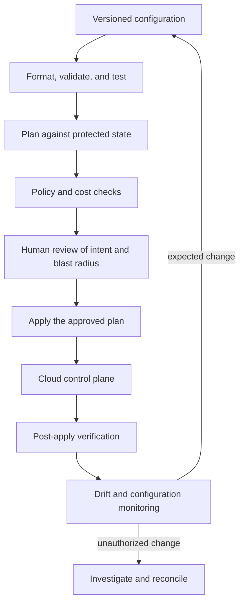

# Infrastructure as Code

Infrastructure as code (IaC) makes desired infrastructure reviewable, reproducible, and governable. The hard problem at scale is not writing a resource block. It is designing ownership and state boundaries, proving that the reviewed change is the one applied, controlling blast radius, and evolving shared modules without blocking every team.

## The change-control system



The plan is a change artifact, not just console output. In an automated Terraform workflow, preserve the reviewed saved plan and apply that artifact. Creating a new plan at apply time can introduce changes that reviewers never saw. Protect plan files as sensitive because they can contain the same kinds of values found in state.

## Choose stack and state boundaries

A stack should have one coherent lifecycle, ownership model, and blast radius. Split infrastructure when components have different privileges, rates of change, recovery needs, or owners. Avoid both extremes: one global state serializes unrelated work and magnifies failures; thousands of tiny states create dependency and discovery overhead.

Common boundaries include organization bootstrap, account or project baselines, regional networks, shared clusters, data services, and application environments. Pass stable outputs through a documented interface or registry rather than allowing arbitrary remote-state reads across trust boundaries.

State is production data:

- store it remotely with encryption, versioning, access control, locking where supported, and audit logs;
- separate read, plan, and apply permissions when the workflow and provider support it;
- exclude local state and saved plans from source control;
- test restoration and document force-unlock or corruption recovery;
- treat `sensitive` as output redaction, not assurance that a value is absent from state;
- prefer short-lived workload identity for automation over static provider credentials.

## Build modules as contracts

A reusable module should encode a stable organizational decision, not wrap every provider argument. Define supported inputs, useful outputs, security defaults, ownership metadata, observability, versioning, and migration policy.

Pin module and provider versions. Use [Semantic Versioning](/docs/Tools/CICD/versioning) as a compatibility signal, but inspect the actual plan before upgrading. Test representative consumers, publish upgrade notes, and keep a deprecation window. A module with broad internal coupling can make a simple provider upgrade an organization-wide migration.

## Work through a concrete change

This simplified Terraform configuration creates an encrypted, versioned S3 bucket and blocks public access. In a real module, naming, ownership tags, logging, retention, replication, and deletion policy would come from explicit requirements.

```hcl
resource "aws_s3_bucket" "artifacts" {
  bucket = "example-production-artifacts"

  tags = {
    owner       = "delivery-platform"
    environment = "production"
    data_class  = "internal"
  }
}

resource "aws_s3_bucket_public_access_block" "artifacts" {
  bucket = aws_s3_bucket.artifacts.id

  block_public_acls       = true
  block_public_policy     = true
  ignore_public_acls      = true
  restrict_public_buckets = true
}

resource "aws_s3_bucket_server_side_encryption_configuration" "artifacts" {
  bucket = aws_s3_bucket.artifacts.id

  rule {
    apply_server_side_encryption_by_default {
      sse_algorithm = "aws:kms"
    }
  }
}

resource "aws_s3_bucket_versioning" "artifacts" {
  bucket = aws_s3_bucket.artifacts.id

  versioning_configuration {
    status = "Enabled"
  }
}
```

Review more than the `4 to add` summary:

1. Does the name collide globally, leak environment information, or require a generated suffix?
2. Which KMS key is used, who administers it, and can the workload encrypt and decrypt?
3. Do bucket policy, organization policy, and account-level public-access settings reinforce the resource controls?
4. Are access logging, retention, lifecycle, recovery, and cross-region requirements satisfied?
5. What prevents accidental destruction, and how would an intentional deletion be approved?
6. Which identity applies the plan, and can that identity bypass the reviewed workflow?

The lesson is that syntactically valid infrastructure is not necessarily operationally complete.

## Test at several layers

| Layer | Finds | Limitation |
| --- | --- | --- |
| Format and validate | Syntax, schema, basic references | Does not evaluate organizational intent |
| Static and policy checks | Disallowed exposure, missing tags, policy violations | Rules can be incomplete or create false confidence |
| Unit or module tests | Inputs, outputs, assertions, upgrade behavior | Provider behavior may differ from mocks |
| Plan review | Concrete additions, changes, replacements, deletions | Depends on current state, credentials, and data sources |
| Ephemeral integration | Real provider and service behavior | Costs time and money; cleanup can fail |
| Post-apply verification | Reachability, policy, telemetry, user behavior | Happens after mutation and needs rollback criteria |

Choose tests by failure cost. A central network or identity module deserves more isolation and upgrade testing than a low-risk sandbox resource.

## Govern policy and exceptions

Policy as code should enforce stable requirements with high signal: approved regions, mandatory encryption, forbidden public exposure, ownership metadata, or restricted identity patterns. Explain failures with remediation guidance. Keep subjective architecture choices in review rather than turning them into brittle rules.

Exceptions need a risk owner, justification, scope, compensating controls, expiry, and a path back to compliance. Track exception patterns; repeated exceptions can reveal a bad module contract or a missing platform capability.

## Handle drift and break-glass changes

Drift can come from incident response, cloud controllers, provider behavior, or unauthorized manual work. Detect it on a schedule and classify it before acting. Blindly overwriting a valid emergency change can recreate an outage.

Define a break-glass path with time-limited access, an incident or change record, audit logging, and mandatory reconciliation into code. Decide whether code adopts the change or the runtime returns to declared state, then verify the result.

## Review IaC like a principal engineer

For a proposed stack, produce:

1. a state and ownership map with trust boundaries and downstream consumers;
2. a plan showing one creation, one in-place update, and one replacement;
3. a policy result and a documented, expiring exception;
4. a module upgrade and consumer migration strategy;
5. a state recovery and break-glass reconciliation exercise;
6. evidence that the reviewed plan, applied artifact, cloud audit event, and post-apply verification refer to the same change.

HashiCorp documents the [automated plan and apply workflow](https://developer.hashicorp.com/terraform/tutorials/automation/automate-terraform), [state protection](https://developer.hashicorp.com/terraform/language/manage-sensitive-data), and [backend behavior](https://developer.hashicorp.com/terraform/language/backend). Return to the [Infrastructure Engineering path](/docs/infrastructure) to place IaC inside the broader foundation lifecycle.
