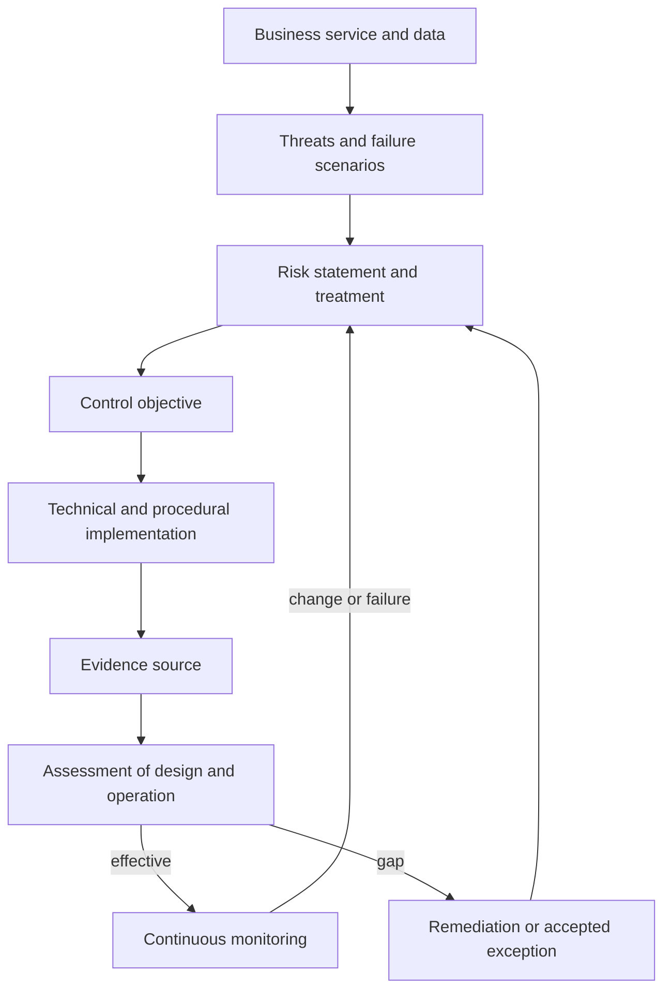

# Security and Compliance in Infrastructure

Infrastructure security reduces the likelihood and impact of misuse, compromise, and failure. Compliance provides a structured claim that required controls are designed and operating. At staff scope, the work is to connect risk to architecture, control ownership, automated enforcement, and evidence without turning the delivery system into an approval queue.

## Connect risk to evidence

Do not begin with a scanner finding or framework identifier. Begin with the service, data, actors, trust boundaries, and plausible loss. A control is useful when its owner can explain which risk it reduces, where it is enforced, how failure is detected, and what evidence shows it operated.

## Establish the responsibility model

Cloud providers secure parts of the physical and managed-service stack. The organization still owns configuration, identities, data use, workload security, and many recovery decisions. Managed services move responsibility; they do not remove it.

For every control, name:

- the accountable owner and the teams that operate contributing mechanisms;
- the resources, data classes, environments, and exceptions in scope;
- the preventive, detective, or corrective mechanism;
- the evidence source, collection frequency, retention, and access;
- the response when the control fails;
- the date or event that triggers reassessment.

## Design defense in depth

### Identity and privileged access

Federate workforce identities, require strong authentication, separate human and workload identities, and prefer short-lived credentials. Use least privilege as an iterative process based on observed access. Protect organization, billing, identity, CI/CD, and security tooling as high-impact control planes.

Break-glass access should be available when normal identity systems fail, but tightly protected, tested, alerted, time-bound, and reviewed after every use.

### Network and workload boundaries

Model ingress, egress, administrative, service-to-service, and control-plane flows. Apply default-deny where the environment can operate it safely, then monitor denied and allowed traffic. Network location alone is not identity; authorize workloads using authenticated identity and context.

Harden images and hosts, run with minimal privileges, patch by risk and exposure, restrict metadata services, and isolate workloads according to tenant and data sensitivity. Admission checks help, but runtime detection and response are still needed.

### Secrets, keys, and data

Classify data and map where it is collected, processed, stored, logged, backed up, replicated, and deleted. Separate key administration from data access where risk warrants it. Rotate credentials based on exposure and system capability, and design applications to survive rotation.

Keep secrets out of source code, ordinary configuration, logs, and IaC state where possible. A secret manager improves storage and delivery; it does not fix excessive access, insecure application handling, or missing revocation.

### Visibility and recovery

Centralize high-value audit events with protected retention and reliable time. Alert on changes to identity, policy, network exposure, logging, encryption, and recovery configuration. Test that responders can query evidence during an incident.

Define RPO and RTO from business impact. Protect backups from the same identities and destructive paths as production, and verify restoration of a complete service rather than only a data file.

## Turn controls into continuous assurance

Use several enforcement points:

1. **Design:** Threat models, data-flow review, and architecture decisions establish intent.
2. **Code:** IaC and application checks find known unsafe patterns before merge.
3. **Plan and admission:** Policy evaluates the concrete change before infrastructure or workloads are accepted.
4. **Runtime:** Configuration monitoring, audit analytics, vulnerability management, and detection identify drift and active threats.
5. **Periodic review:** Access, recovery, incident, supplier, and exception reviews cover controls that cannot be inferred from configuration alone.

Automation should preserve provenance: which policy version evaluated which artifact or resource, with which result, at what time. A green dashboard without scope and provenance is weak evidence.

## Worked control-to-evidence example

| Field | Example: privileged production changes |
| --- | --- |
| Risk | A compromised or misused identity changes production infrastructure and causes exposure or outage |
| Objective | Only authorized, reviewed automation can make routine production changes |
| Preventive implementation | Protected main branch, reviewed saved plan, workload identity, restricted apply role, policy checks |
| Detective implementation | Cloud audit logs alert on direct changes and apply-role assumption outside the workflow |
| Evidence | Review record, plan digest, CI run, identity token claims, policy result, cloud audit event, post-apply check |
| Owner and frequency | Infrastructure owner; continuous collection with quarterly access and control review |
| Failure response | Disable identity, investigate scope, reconcile drift, record incident, repair control gap |

This evidence chain should let an assessor connect intent to the exact production mutation. Screenshots and manually assembled documents are less reliable than durable system records with stable identifiers.

## Map frameworks without duplicating systems

Build a control library around organizational risks and objectives, then map framework requirements such as SOC 2, ISO 27001, PCI DSS, or NIST guidance onto those controls. One well-designed access review can satisfy several mapped requirements. Separate the reusable control from framework-specific wording and scope.

Compliance is not proof of complete security. A control can pass its scheduled assessment while a different threat remains untreated. Feed incidents, threat intelligence, architecture changes, and new data uses back into the risk model.

## Govern exceptions and remediation

An exception must identify the unmet control, affected scope, risk owner, business reason, compensating controls, measurable exposure, expiry, and remediation plan. High-risk exceptions require explicit escalation. Expired exceptions should fail visibly rather than renew silently.

Prioritize remediation using exploitability, exposure, asset importance, compensating controls, and expected loss—not severity labels alone. Track time to contain critical exposure, recurrence, exception age, and the percentage of important controls with verified evidence.

## Review security like a principal engineer

Extend the [service lab](/labs/build-and-operate-a-service) with a security and assurance package:

1. Draw data, identity, administration, and software-supply-chain trust boundaries.
2. Write three threat scenarios and connect each to preventive, detective, and recovery controls.
3. Define a production-change control with an end-to-end evidence chain.
4. Show how direct cloud changes are detected and reconciled to IaC.
5. Design break-glass access and run a tabletop exercise for identity-provider failure.
6. Document one expiring exception with compensating controls and an accountable risk owner.
7. Map the controls to one framework while keeping the organizational control model independent.

NIST [SP 800-53A](https://csrc.nist.gov/pubs/sp/800/53/a/r5/final) provides a model for assessing whether controls are correctly implemented and operating as intended. Apply this note with the [IaC workflow](/docs/infrastructure/infrastructure-as-code), then return to [Infrastructure Engineering](/docs/infrastructure). For application concerns, continue to the [Security notes](/docs/Security).
