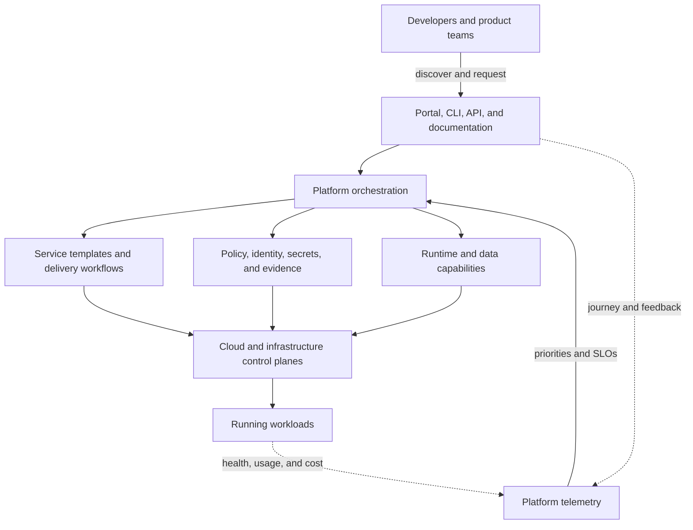

# Platform Engineering

Platform engineering turns recurring engineering capabilities into an internal product. At staff and principal scope, the task is to reduce cognitive load across many teams without creating a rigid central bottleneck. The platform succeeds when users can deliver and operate software more safely with less coordination.

## Treat the platform as an interface

The developer interface may be a portal, CLI, API, repository template, or documentation. The product is the dependable capability behind that interface, including support, lifecycle, security, and recovery.

## Start with a user journey

Interview developers and observe real work before choosing a portal or control plane. Map a journey such as “create and deploy a compliant HTTP service” from intent to verified production. Record waits, handoffs, repeated decisions, failure recovery, and the expertise required at each step.

A platform opportunity is strong when the need is repeated across teams, the capability can have a stable contract, and central ownership reduces total cognitive load. A one-off expert task may need documentation or an enabling engagement instead of a product.

## Define a platform capability

Each capability needs more than automation:

| Contract area | Questions to answer |
| --- | --- |
| User outcome | What job becomes faster, safer, or possible? |
| Interface | Which inputs are required, and what resource or workflow is returned? |
| Ownership | What does the platform operate, and what remains with the service team? |
| Guardrails | Which defaults and policies are mandatory, configurable, or advisory? |
| Reliability | What SLO, support path, recovery behavior, and maintenance window apply? |
| Lifecycle | How are versions, migrations, deprecations, and deletion handled? |
| Economics | Which costs are visible to the consumer, and what limits protect shared capacity? |

Version the contract independently from implementation. Product teams should not need to understand every cloud API or controller, but they must be able to predict the platform's behavior and diagnose their side of the boundary.

## Build paved roads with exits

A paved road combines a supported template, delivery workflow, runtime, observability, security controls, and operating guidance for a common workload. Good defaults remove decisions that do not differentiate the product.

Avoid turning the paved road into a golden cage. Publish extension points and an exception path. An exception should record ownership, risk, support expectations, and an exit or review date. Patterns that recur in exceptions are product discovery data.

Use progressive disclosure: make the common task simple while preserving deeper controls for teams that need them. Hiding every underlying detail can make incidents harder; exposing every infrastructure choice defeats the platform's purpose.

## Separate platform layers

Useful boundaries often include:

- **Experience layer:** documentation, catalog, portal, CLI, API, and feedback.
- **Orchestration layer:** workflows that compose capabilities and manage long-running state.
- **Capability layer:** delivery, runtime, data, messaging, identity, secrets, observability, and cost.
- **Foundation layer:** cloud accounts, networks, clusters, policy engines, and infrastructure APIs.

Do not make the portal a second source of truth. Store durable desired state in versioned systems or well-defined control planes. Make reconciliation idempotent and surface partial failure instead of reporting a workflow complete before dependencies converge.

## Run the platform as a reliable service

The platform participates in the availability of every consumer. Define SLOs for actions users depend on: environment provisioning, deployment orchestration, credential issuance, catalog lookup, or runtime availability.

Design for control-plane failure. Existing workloads should keep serving when the portal or orchestrator is unavailable. Queue or reject mutations predictably, preserve audit history, test backup and restore, and document how the platform itself is bootstrapped after a broad outage.

Manage multi-tenant fairness through quotas, rate limits, capacity reservations, and isolation. Track the blast radius of shared controllers, templates, policy changes, and fleet upgrades.

## Measure product and engineering outcomes

Adoption alone can reflect a mandate. Satisfaction alone can hide poor delivery outcomes. Use a balanced scorecard:

- **User experience:** task success, time to first production deploy, documentation success, satisfaction, and support burden.
- **Adoption and retention:** eligible teams using each capability, repeat usage, abandoned journeys, and exceptions.
- **Delivery outcomes:** lead time, deployment frequency, failed-deployment recovery time, change fail rate, and rework.
- **Reliability and safety:** platform SLOs, policy coverage, incident blast radius, and recovery evidence.
- **Economics:** platform team cost, shared infrastructure efficiency, unit cost, and consumer time saved.

Instrument the journey, not individual developer activity. Metrics should reveal friction and product risk without becoming surveillance or performance scoring.

## Design the organization around the product

The platform team needs product management, software engineering, infrastructure, reliability, security, and developer-experience capability. It should own a coherent product surface rather than act as a queue for every operational request.

Use enabling engagements to help early adopters, learn where contracts fail, and transfer knowledge. Establish contribution rules so domain teams can improve shared capabilities without leaving the platform team unable to support them.

| Staff-level decision | Evidence | Common trap |
| --- | --- | --- |
| Build or buy | Differentiation, integration cost, lifecycle ownership, exit cost | Comparing license cost only |
| Add a capability | Repeated user need, stable boundary, measurable outcome | Building from a technology roadmap |
| Mandate adoption | Material risk, migration capacity, proven fit | Using mandate to compensate for poor usability |
| Support an exception | Workload need, risk owner, duration, support model | Permanent bespoke paths with hidden ownership |
| Deprecate a version | Usage, migration tooling, consumer impact, security risk | Announcing a date without funding migration |
| Federate ownership | Clear interfaces, contribution and SLO model | Central standards with distributed ambiguity |

## Evolve by maturity, not platform size

Begin with one high-value journey and a minimum viable platform. Prove fit with a few teams, improve the contract, then scale through self-service, reliability, and governance. Different capabilities can be at different maturity levels; a large portal does not imply a mature platform.

At principal scope, connect the platform roadmap to business constraints: product lead time, regulatory evidence, cloud cost, acquisition integration, regional expansion, or operational risk. Retire capabilities when their outcome disappears or a simpler managed service now provides it.

## Review a platform like a principal engineer

Use the [service lab](/labs/build-and-operate-a-service) as the first platform journey:

1. Define the target users and the job they are trying to complete.
2. Specify the service template, delivery, runtime, observability, identity, and support contracts.
3. Draw the desired-state and reconciliation flow, including partial failures and deletion.
4. State what the service team owns and what the platform operates.
5. Define an escape hatch and show how its risk and lifecycle are governed.
6. Choose product, delivery, reliability, and cost metrics with a baseline and target.
7. Write a 90-day roadmap that tests the riskiest product assumption before scaling.

## Evidence of principal-level depth

A strong portfolio demonstration includes user research, a journey map, a versioned capability contract, a reference architecture, platform SLOs, an exception and deprecation policy, a balanced scorecard, and a roadmap tied to organizational outcomes.

Continue with the [delivery stages](/docs/DevSecOps/process/1.code), [CI systems](/docs/Tools/CICD/github-actions), [systems design](/docs/System-Design), and [feedback loops](/field-notes/ci-feedback-loop).

The CNCF [Platform Engineering Maturity Model](https://tag-app-delivery.cncf.io/whitepapers/platform-eng-maturity-model/) offers a framework for evaluating capabilities independently. DORA's [platform engineering guidance](https://dora.dev/capabilities/platform-engineering/) connects platform work to delivery and developer outcomes.
