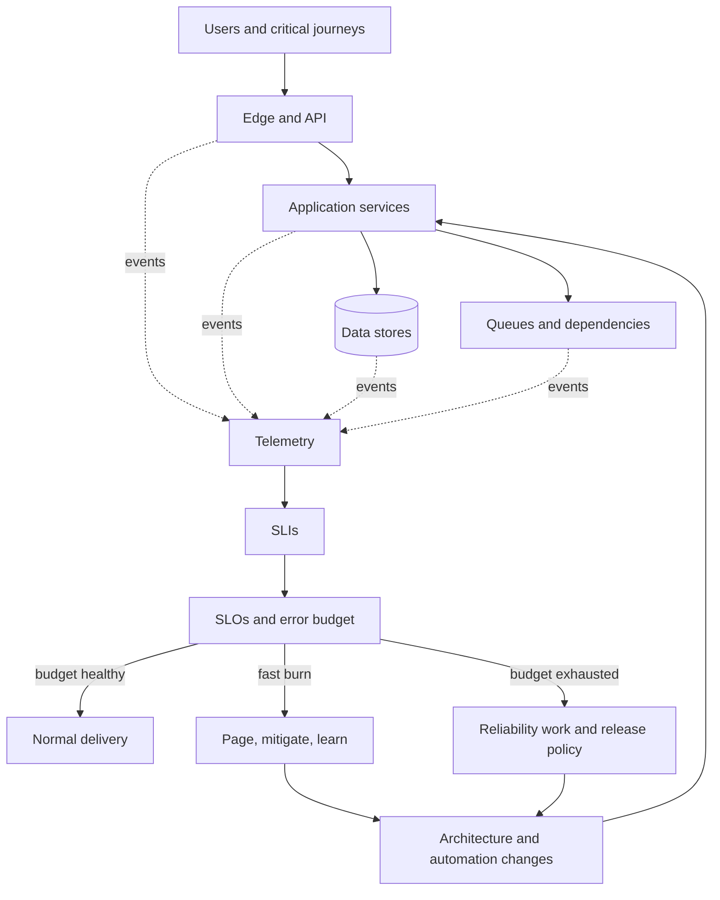

# Site Reliability Engineering

Site Reliability Engineering turns reliability from an aspiration into an operating model. The staff-level problem is not adding more alerts. It is deciding which user journeys deserve protection, how much failure the business will accept, and how architecture, delivery, capacity, and incident response should change when the service is outside that boundary.

## The reliability control loop

The loop matters more than any monitoring tool. A metric becomes operationally useful when it can change a decision: page an operator, stop a rollout, shed load, spend capacity, or prioritize reliability work.

## Start with the user contract

Choose a small set of **critical user journeys** such as signing in, placing an order, or processing a payment. Define each journey's success criteria and the boundary of responsibility.

| Concept | Staff-level question | Example |
| --- | --- | --- |
| Service-level indicator (SLI) | What directly measures a user's successful experience? | Valid responses under 500 ms divided by eligible requests |
| Service-level objective (SLO) | What target is useful enough without paying for unnecessary reliability? | 99.9% over a rolling 28-day window |
| Error budget | How much unreliability can the service consume? | 0.1% of eligible requests |
| Error-budget policy | What changes when the budget burns too quickly? | Pause risky releases; prioritize the dominant failure mode |

An SLO needs exclusions, ownership, a measurement source, and consequences. Avoid using infrastructure health as a substitute for user outcomes: every pod can be running while checkout is broken.

Use multiple windows to distinguish a sharp outage from a slow regression. A fast burn should page; a slow burn can create a ticket. The alert must describe the user impact and point to a mitigation path.

## Engineer the failure domains

A principal engineer reasons about how failures propagate across the graph, not only how an individual component fails.

- **Dependencies:** Assign timeouts, retry budgets, circuit breaking, and fallback behavior. Retries without limits amplify overload.
- **Capacity:** Model demand, saturation, queue growth, and scaling delay. Reserve headroom for failover and unexpected traffic.
- **Overload:** Prefer bounded queues, admission control, load shedding, and degraded responses over total collapse.
- **State:** Define consistency and durability requirements before choosing replication, backup, and recovery mechanisms.
- **Change:** Use small batches, progressive delivery, automated rollback, and compatibility across mixed versions.
- **Failure containment:** Align cells, regions, tenants, and deployment units so one fault cannot consume the whole service.

Availability is a property of a path. If a request depends serially on three 99.9% components, the path will be less available than any one component. Redundancy only helps when replicas do not share the same failure mode.

## Operate incidents as a system

During an incident, separate coordination from diagnosis. One person owns command, another drives technical mitigation, and communications maintain a shared view of impact and decisions. Restore service first; pursue full causal analysis after the system is safe.

A useful incident lifecycle is:

1. **Detect and qualify:** Establish user impact, severity, scope, and the first safe action.
2. **Stabilize:** Roll back, fail over, shed load, disable a feature, or reduce dependency pressure.
3. **Recover and verify:** Validate the critical journey and watch for recurrence, backlog, or data repair.
4. **Learn:** Build a timeline, identify contributing conditions, and explain why safeguards did not prevent or limit impact.
5. **Change the system:** Assign durable actions with owners and verification. Track whether the same failure class returns.

Post-incident review is an engineering input, not a search for the person nearest the trigger. Strong actions modify architecture, tests, rollout controls, observability, or operating procedures. “Be more careful” is not a control.

## Manage toil and on-call health

Toil is manual, repetitive, automatable work that scales with service growth and creates little enduring value. Measure it by source and remove the work that most damages response quality or prevents engineering investment.

An on-call system needs actionable pages, sustainable rotation size, documented escalation, production access, and time to fix recurring causes. Track pages per shift, after-hours load, false positives, time to acknowledge, and repeated incident classes. A quiet rotation is not automatically healthy if failures are invisible.

## Govern reliability across teams

Staff and principal SRE work is often a negotiation across product, application, infrastructure, security, and support teams.

| Decision | Evidence to bring | Failure to avoid |
| --- | --- | --- |
| Raise an SLO | User need, current performance, architecture cost, support impact | Treating more nines as free |
| Stop releases | Error-budget burn, dominant cause, policy agreed in advance | Using the budget as punishment |
| Add a region | Recovery objective, correlated risks, data design, failover tests | Buying idle capacity without a proven failover path |
| Accept a dependency | Contract, observed reliability, fallback, ownership | Inheriting a weaker SLO invisibly |
| Fund reliability work | Incident cost, toil, budget trend, risk reduction | Prioritizing by anecdote or alert volume |

Reliability governance should make ownership and escalation explicit while leaving service teams able to operate their systems. Central standards should define outcomes and interfaces; teams should retain room to meet them in context.

## Review a service like a staff engineer

For the [build and operate a service lab](/labs/build-and-operate-a-service), produce a short reliability review:

1. Name one critical user journey and define its eligibility, success, and latency SLIs.
2. Choose an SLO and calculate its error budget for a 28-day window.
3. Draw the request path and mark shared failure domains and hard dependencies.
4. Define a fast-burn page, a slow-burn ticket, and the action attached to each.
5. Describe overload behavior, rollback, backup restore, and one regional failure scenario.
6. Write an error-budget policy that product and engineering leaders could approve.

## Evidence of principal-level depth

A strong portfolio demonstration includes an SLO specification, dashboard and burn-rate alerts, an incident command playbook, a post-incident review with verified actions, a capacity model, and an architecture decision that quantifies a reliability tradeoff.

Continue with [monitoring](/docs/DevSecOps/process/7.monitor), [operations](/docs/DevSecOps/process/6.operate), [distributed systems](/docs/OMSCS/CS7210-Distributed-Systems), and the [CI feedback-loop note](/field-notes/ci-feedback-loop). Google's [SRE Workbook](https://sre.google/workbook/table-of-contents/) provides deeper implementation guidance for SLOs, alerting, incident response, overload, and error-budget policy.
